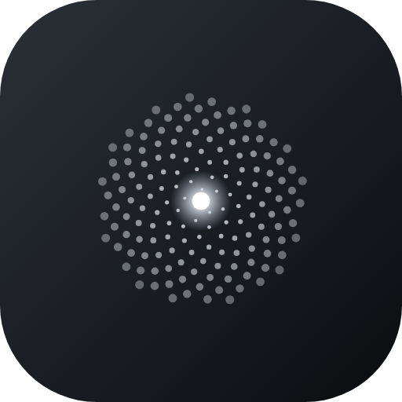
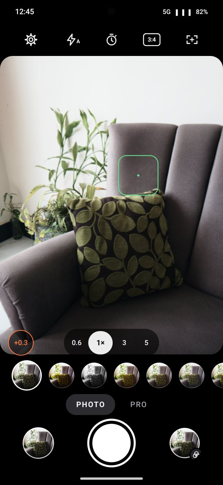
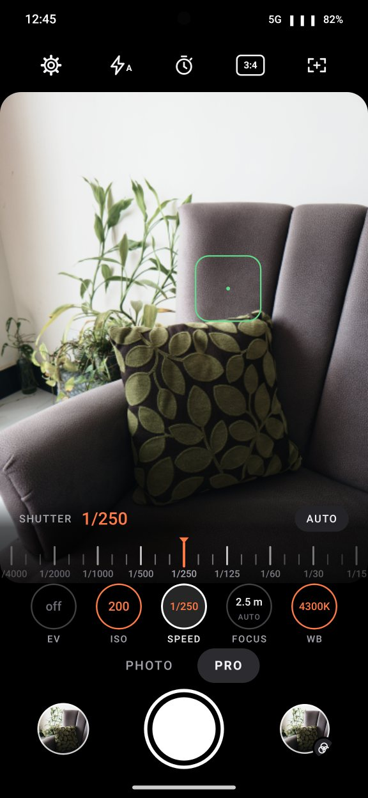
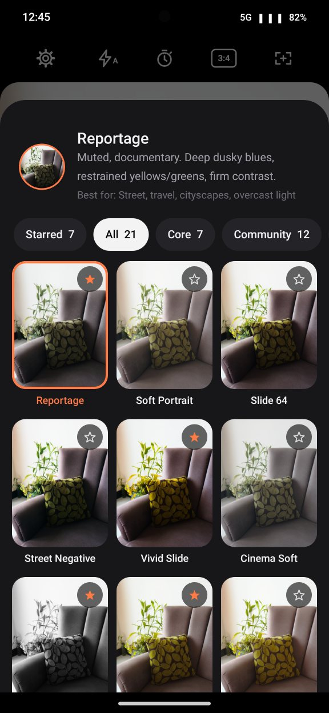

# Silverpoint

[](https://github.com/reki-reki/Silverpoint/actions/workflows/build.yml)
[](LICENSE)


**A RAW camera for the Samsung Galaxy S25 Ultra that skips Samsung's image processing and develops every photo with a film-style look.**

Silverpoint captures a RAW frame through Android's Camera2 API, develops it on the GPU with its own pipeline, applies one of 21 film-inspired looks, and saves the finished JPEG straight to your Gallery.

<p align="center"></p>

<p align="center">
  
  
  
  
</p>

> **Status: beta (0.9.9).**
> - **Done:** every feature below is built.
> - **Checked on the phone:** the capability probe, the GPU self-test, the base colour rendering and the camera screen.
> - **Not yet run end to end:** the full device checklist ([docs/DEVICE_TESTING.md](docs/DEVICE_TESTING.md)); it is the main item left before 1.0 ([docs/RELEASING.md](docs/RELEASING.md)).

## Why

Samsung's camera app runs heavy multi-frame processing (HDR, AI scene tuning, Samsung colour science) before you see a photo. Film-simulation "recipes", popular with Fujifilm shooters, give a consistent, finished look straight out of the camera. Silverpoint combines the two on a phone: it starts from unprocessed sensor data, then applies the look you picked.

## Features

- **RAW capture on all four rear lenses** (0.6×, 1×, 3×, 5×; 12.5 MP each), bypassing Samsung's processing.
- **21 looks** ([list](docs/RECIPES.md)), each built from a Lightroom preset. Every slider is applied: tone, point and channel curves, HSL, black and white, split toning and colour grading, calibration, clarity, texture, sharpening, vignette and film grain ([how](docs/RECIPE_ENGINE.md)). Looks are matched against Lightroom exports of the same RAW files ([findings](docs/LIGHTROOM_MATCHING.md)).
- **Look selector** with live previews of your scene through every look, about 30 times a second, sorted into tabs. Starred looks form a quick row under the viewfinder.
- **Live viewfinder with the look applied** (approximate, see [limitations](#known-limitations)), plus grid, level, histogram, zebras and focus peaking.
- **Pro mode** with Samsung-style dials and haptic detents for EV, ISO, shutter speed, focus and Kelvin white balance with tint. Setting only ISO or only the shutter gives shutter or ISO priority.
- **Flash** (Off, Auto, On) and **four shapes**: 3:4, 4:5, 1:1 and 9:16. The DNG always keeps the whole sensor.
- **Multi-frame merge** for cleaner low-light shots: six frames aligned and averaged, with moving objects left out.
- **Ultra HDR JPEGs:** highlights glow on HDR screens, and the photo looks normal everywhere else.
- **Straight to the Gallery** (`DCIM/Silverpoint`), with the look recorded in EXIF and no location. Photos develop in the background, so the shutter is ready again at once.
- **Tap to focus and meter**, double tap to reset; self-timer of 2, 5 or 10 s; an optional DNG next to each photo.
- **Diagnostics:** checks what the phone allows and compares the GPU developer with the CPU reference.
- **Private by design:** no internet permission, no accounts, no analytics.

## Known limitations

- **RAW is capped at 12.5 MP.** The S25 Ultra exposes no maximum-resolution RAW mode to apps, so Silverpoint shoots the 200 MP sensor's binned 12.5 MP RAW, which also keeps noise low.
- **Exposure compensation is ±2 EV**, the phone's full range. The phone has no hybrid auto-exposure or Kelvin white-balance modes, so Pro mode emulates shutter and ISO priority and does white balance in Silverpoint's own pipeline.
- **Exposures stop at about 1/6 s and ISO 3200** on the main lens. Merging lowers noise but is not a long exposure.
- **The viewfinder is approximate.** It applies the look to the phone's processed video stream; the saved photo is developed from RAW.
- **The looks approximate Lightroom's engine.** Four are fitted to Lightroom exports; the others use the corrections those fits had in common ([DESIGN_DECISIONS.md](docs/DESIGN_DECISIONS.md), R1 and R6).
- **No lens distortion correction yet**; it is mostly visible on the ultrawide.
- **Real phone only.** Emulators have no RAW sensor.

## Requirements

- **Phone:** Samsung Galaxy S25 Ultra. It is the only phone tested; others with RAW support may work, and the Diagnostics screen tells you.
- **Android:** 14 or newer.
- **Camera:** Camera2 with the `RAW` and `MANUAL_SENSOR` capabilities.

## Install

There is no store release yet.

- **Releases:** when a version is published, its APK is attached to the repository's **Releases** page.
- **Development builds:** every push to `main` builds a debug APK in CI.
  1. Open the latest run under **Actions** and download the `silverpoint-debug-apk` artifact.
  2. Unzip it, copy `app-debug.apk` to the phone and install it. Allow installs from your file manager when Android asks.

## Using the app

1. **First launch:** open **Silverpoint**, read or skip the short introduction, and allow camera access.
2. **Top bar:** Settings, Flash, Timer, Shape and Viewfinder aids. Tap one and the bar shows its choices.
3. **Lenses and exposure:** pick a lens (0.6, 1, 3, 5) at the bottom of the viewfinder. Tap to focus and meter on a spot; double tap to go back to automatic. The **±** button opens the exposure dial.
4. **Looks:** flick through your starred looks in the row under the viewfinder. The button to the right of the shutter opens every look with a live preview; tap a star to keep a look in the quick row.
5. **Shooting:** tap the shutter. The photo develops in the background and appears in the *Silverpoint* album; the thumbnail on the left opens it.
6. **Pro mode:** tap **PRO**, or swipe the viewfinder. Each setting is a round button showing its value; tap one for its dial, and **AUTO** hands it back. Swipe back or tap **PHOTO** to leave.
7. **Settings:** live previews, haptics, merge mode, Ultra HDR, DNG, Diagnostics, and how long the last photo took to develop.

## Diagnostics

**Settings → Diagnostics → Run diagnostics**, pointed at a well-lit scene. It takes about a minute and checks:
- RAW on every lens;
- whether manual ISO and shutter are honoured;
- lens-switch time;
- a pixel-by-pixel comparison of the GPU developer against the CPU reference.

Each run saves a JSON report and one DNG per lens to `Download/Silverpoint/diag_<run ID>/`; nothing goes to your Gallery. Attach the report to a *Device report* issue. Results so far are in [docs/PROBE_RESULTS.md](docs/PROBE_RESULTS.md).

## Build from source

You need JDK 17 or newer and the Android SDK (platform `android-37.0`, build-tools `36.0.0`). No NDK.

```bash
git clone https://github.com/reki-reki/Silverpoint.git
cd Silverpoint
./gradlew assembleDebug                       # debug APK in app/build/outputs/apk/debug/
./gradlew lint testDebugUnitTest              # what CI runs
./gradlew assembleRelease                     # shrunk release APK (signing: docs/RELEASING.md)
```

[docs/DEVELOPMENT.md](docs/DEVELOPMENT.md) covers the code map, the rule that keeps the GPU and CPU developers identical, and the developer tools.

## Documentation

| Document | What it covers |
|---|---|
| [ARCHITECTURE](docs/ARCHITECTURE.md) | Technical choices, data flow, GPU pipeline, merge, Ultra HDR |
| [DESIGN_DECISIONS](docs/DESIGN_DECISIONS.md) | Every default, why it was chosen, and where to change it |
| [RECIPE_ENGINE](docs/RECIPE_ENGINE.md) · [RECIPES](docs/RECIPES.md) · [LIGHTROOM_MATCHING](docs/LIGHTROOM_MATCHING.md) | How looks are built, the list, and how they were matched to Lightroom |
| [PROBE_RESULTS](docs/PROBE_RESULTS.md) | What the S25 Ultra allows an app to do |
| [DEVICE_TESTING](docs/DEVICE_TESTING.md) | A 30-minute walk through the app on a phone |
| [DEVELOPMENT](docs/DEVELOPMENT.md) · [RELEASING](docs/RELEASING.md) | Working on the code; publishing a release |
| [proposals/XMP_IMPORT](docs/proposals/XMP_IMPORT.md) | Planned: importing your own Lightroom presets (feasibility) |

## Upcoming features

**Next update**
- Import your own Lightroom presets (`.xmp`, DNG and `.zip`), shown in a "My looks" tab.
- Re-develop a past photo with another look.
- Look strength slider.
- Film effects: halation, light leaks, borders, date stamp.
- Volume-key shutter and AE/AF lock.
- Before/after compare.
- More Galaxy phones, added gradually after testing. Device reports with the Diagnostics report, a JPEG and its DNG help most ([CONTRIBUTING.md](CONTRIBUTING.md)).

**Planned**
- Make your own look.
- Long exposure.
- Exposure bracketing.
- Intervalometer and time-lapse.
- Landscape layout.
- Open from the side key and other apps.
- Quick Settings tile and home-screen shortcut.
- Opt-in location tagging.

Details and progress: [ROADMAP.md](ROADMAP.md).

## Tech stack

- **UI:** Kotlin and Jetpack Compose.
- **Capture:** Camera2.
- **RAW pipeline:** OpenGL ES 3.1 compute shaders driven from Kotlin, mirrored by a CPU reference developer.
- **Live viewfinder and look previews:** an OpenGL ES 3.0 renderer.
- **JPEG and Ultra HDR:** Android's own `Bitmap.compress` and `Gainmap`.
- **No native code.**

## Contributing

Bug reports, device reports (especially from other Galaxy models) and pull requests are welcome. Please read [CONTRIBUTING.md](CONTRIBUTING.md) first. By taking part you agree to follow the [Code of Conduct](CODE_OF_CONDUCT.md). Report security issues as described in [SECURITY.md](SECURITY.md).

## License

Licensed under the [Apache License 2.0](LICENSE). Third-party components and their licenses are listed in [THIRD_PARTY_NOTICES.md](THIRD_PARTY_NOTICES.md).

## Trademarks and disclaimer

The looks have original names, and the app shows no film or camera brand names. [docs/RECIPES.md](docs/RECIPES.md) names the film stocks and community recipes that inspired each look, to describe it; Silverpoint is not affiliated with or endorsed by Fujifilm, Eastman Kodak, CineStill or anyone else named there, and the looks are original approximations, not their colour science. Samsung and Galaxy are trademarks of Samsung Electronics. Lightroom is a trademark of Adobe.

## Credits

- **Built with Claude.** Silverpoint was written by [Claude](https://www.anthropic.com/claude), Anthropic's AI model, working in [Claude Code](https://claude.com/claude-code). This covers the camera and RAW pipeline, the GPU shaders, the look engine and Lightroom matching, the interface, the tests and the documentation. The maintainer, [reki-reki](https://github.com/reki-reki), set the direction, made the product decisions, supplied the Lightroom presets and reference photos, and tested the app on the phone. Commits written by Claude carry a `Co-Authored-By: Claude` line.
- **Look references:** the [Fuji X Weekly](https://fujixweekly.com/) community's film-simulation recipes ([per-look references](docs/RECIPES.md)).
- **Multi-frame merge:** follows the ideas of the HDR+ paper (Hasinoff et al., *Burst photography for high dynamic range and low-light imaging on mobile cameras*, SIGGRAPH Asia 2016), re-implemented from the paper.
